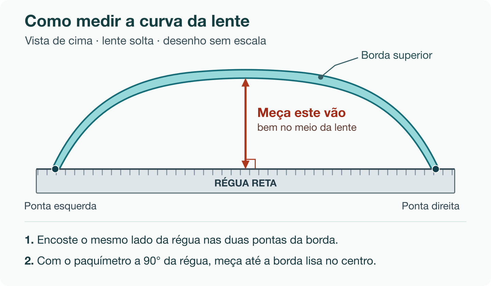

# Haste de reposição para óculos de lente panorâmica

A lente está inteira e a haste quebrou? Este modelo 3MF para impressão 3D permite testar uma haste de reposição com uma lente panorâmica de peça única. A borda superior da lente tem uma aba curva com três ressaltos. A aba entra pela frente da barra. Os ressaltos se acomodam em três rebaixos, cada um com uma lingueta de retenção. A armação usa três peças em PETG: uma barra e duas hastes dobráveis, cada uma com o próprio eixo de pontas esféricas.

## Escolha sua impressora

| Impressora | Projeto em PETG | Abra com |
| --- | --- | --- |
| Bambu Lab A1 | [Baixar haste-oculos-petg_A1.3mf](https://github.com/MoraesGil/haste-oculos-lente-panoramica/releases/download/v0.5.0/haste-oculos-petg_A1.3mf) | Bambu Studio 2.9 |
| Snapmaker U1 | [Baixar haste-oculos-petg_U1.3mf](https://github.com/MoraesGil/haste-oculos-lente-panoramica/releases/download/v0.5.0/haste-oculos-petg_U1.3mf) | Snapmaker Orca |

[Baixar o editor HTML para uso offline](https://github.com/MoraesGil/haste-oculos-lente-panoramica/releases/download/v0.5.0/haste-oculos-editor.html)

**Para montar uma armação, imprima a barra da mesa 2 e as duas hastes da mesa 3.** A mesa 1 mostra as três peças montadas. A mesa 4 é opcional e serve para experimentar o encaixe com pouco PETG.

[](https://github.com/MoraesGil/haste-oculos-lente-panoramica/releases/download/v0.5.0/haste-oculos-editor.html)

## Como reconhecer a lente

A lente é uma peça única que envolve as laterais do rosto. Para reconhecer o encaixe, olhe a aba da borda superior. Há um ressalto acima do nariz e um de cada lado. Os três entram pela frente da barra. Cada ressalto passa pela mini-rampa da lingueta e assenta em um rebaixo aberto pela face inferior do arco. A face de retenção intercepta a travinha quando se tenta puxar a lente para fora.

| Onde encostar o paquímetro | Medida do exemplar |
| --- | ---: |
| Entre as duas pontas da lente, em linha reta na vista frontal | 150 mm |
| Do centro do ressalto central ao centro de cada lateral, na projeção frontal | 37 mm por lado (74 mm de centro a centro entre os dois laterais) |
| Largura × profundidade × altura **adicional** de cada ressalto | 8 × 1 × 1 mm |
| Entre as faces da aba lisa / entre as faces na altura do ressalto | 2 mm / 3 mm |
| Da ponta livre da aba até a primeira e a segunda face do mesmo ressalto, vista de cima | 2,9 mm / 3,9 mm |
| Curso da lente na entrada frontal | 5,2 mm |

A largura de 150 mm pertence à lente. A distância de 37 mm se mede horizontalmente na vista frontal, entre os centros de dois ressaltos vizinhos. Os 2,9 mm resultam da medida de 3,9 mm menos a profundidade do ressalto (1 mm).

<details>
<summary>Como medir a curvatura da lente com uma régua e um paquímetro</summary>

Vista de cima, apoie a mesma borda de uma régua nas duas pontas da aba. Meça a distância perpendicular da régua até a borda lisa no centro da lente, ao lado do ressalto. O perfil fica mais curvo perto das pontas. O editor permite ajustar essa profundidade.



</details>

Cada ponta do eixo da haste tem uma esfera de **3,70 mm** em um alojamento nominal de **4,00 mm**. A garganta de **3,54 mm** cria retenção nominal de **0,16 mm no diâmetro**. O editor permite ajustar as duas medidas separadamente. Use os corpos de prova da mesa 4 para decidir com o seu PETG.

A curvatura desta revisão usa uma profundidade de **42 mm**. A leitura da régua em duas fotos ficou em aproximadamente 42,6 e 41,6 mm. Essa diferença reflete a perspectiva e a escolha da borda transparente. A forma entre o centro e as pontas usa o perfil traçado do exemplar. O gabarito da mesa 4 permite comparar a curva e os três rebaixos com a lente real antes de imprimir a armação completa.

## Como usar o editor

1. Baixe o HTML e abra o arquivo no navegador. Veja as cotas nas vistas frontal, superior e em corte. A cota indica qual distância medir e mostra o valor em milímetros.
2. Selecione a medida no desenho e digite o valor da sua lente. O corte mostra a espessura lisa e a região com o ressalto. A vista superior mostra onde apoiar a régua para medir a curva.
3. Mova **Entrada frontal da lente** para ver a travinha passar pela mini-rampa e assentar no baixo-relevo. O corte mostra o movimento da lingueta. Escolha **Barra superior** e **Por baixo** para ver os três rebaixos sem a lente. As cotas do vão, da rampa e do guia superior ficam junto ao corte. Use **Dobrar as hastes** para ver a montagem em movimento.
4. Use **Salvar HTML** para guardar suas medidas. Para imprimir uma peça personalizada, selecione a peça e use **Baixar STL**. Os dois projetos 3MF contêm as medidas de referência desta release.


<a id="como-imprimir-na-bambu-lab-a1"></a>

## Como imprimir

1. Escolha o 3MF da sua impressora na tabela acima. Use **Arquivo → Abrir projeto** no fatiador correspondente para carregar as quatro mesas.
2. Confira a impressora, o bico de **0,4 mm** e o material **PETG**. Os arquivos usam a chapa lisa **SuperTack a 70 °C**. Se a chapa instalada for outra, selecione a sua no fatiador.
3. Selecione **Fatiar mesa** para preparar cada mesa que deseja imprimir.

| Mesa | O que aparece no projeto | Quando usar |
| --- | --- | --- |
| **1 · Prévia** | Uma montagem com **três peças**, suspensa 3 mm acima da chapa | Gire o modelo para ver como as hastes entram na barra. Pule esta mesa na impressão. |
| **2 · Barra central** | **Uma peça** com o canal frontal da lente e os dois garfos laterais | Imprima uma vez para montar a armação. |
| **3 · Duas hastes** | **Duas peças** lado a lado, cada uma com o eixo e as duas pontas esféricas integrados | Imprima a mesa uma vez para obter o par. |
| **4 · Testes opcionais** | Um garfo curto, uma ponta curta de haste e um gabarito curvo para a lente | Os dois corpos curtos testam a dobradiça. O gabarito testa a lente. Nenhum deles entra na armação final. |


### Como testar e montar a dobradiça

1. Na **mesa 4**, desative o gabarito curvo para imprimir só o **garfo curto** e a **ponta curta da haste**. Use o mesmo PETG e os mesmos ajustes que pretende usar nas peças inteiras.
2. Retire os suportes externos. Segure o garfo perto da abertura. Alinhe as duas esferas da haste com as duas entradas do garfo. Aproxime a haste **do lado da orelha em direção à barra**, como mostra o corte.
3. Pressione as duas esferas juntas. Pare se for preciso forçar ou se o PETG ficar branco ou trincar. Depois de assentar, a haste deve girar à mão e permanecer presa.
4. Aprovado o teste, repita a montagem com a barra da **mesa 2** e cada haste da **mesa 3**. Dobre uma haste por vez.


Nos dois arquivos, a montagem da mesa 1 é um único objeto com três partes. A posição relativa é a mesma das peças impressas depois de encaixadas. Os pivôs acompanham as duas extremidades da barra quando você ajusta a curva no editor. As mesas 2, 3 e 4 foram fatiadas no Bambu Studio 2.9.1.70 para a A1 e no Snapmaker Orca para a U1. Os alojamentos, suas entradas e o canal da lente ficaram livres de trajetos de suporte. No modelo, a lente assenta com as três saliências nos rebaixos. A verificação digital também conferiu o assento das quatro esferas e o giro das hastes em sequência. A prova de bancada mede a firmeza com o PETG da sua impressora.

### Como encaixar a lente

**Aba alinhada à boca → cada travinha sobe pela mini-rampa → a lingueta retorna → travinha presa no baixo-relevo.**

O corpo da barra e a faixa dianteira acompanham o mesmo arco. O modelo adota **2,00 mm** de distância livre vertical entre as duas faces opostas. Nos pontos dos pinos, o apoio recua e deixa ver, por baixo, o aro e o fundo de cada rebaixo. Na configuração inicial, a parte inclinada tem cerca de **1,1 mm** em Y e o guia tem **1,2 mm** em Z. O sentido vertical da cota de 2 mm, a extensão do recuo e as dimensões da rampa e do guia são escolhas de projeto a conferir no gabarito. A curva da lente, o curso de entrada e a posição dos ressaltos seguem as cotas do exemplar.

Faça a prova de encaixe na bancada. Pare se precisar torcer a lente, se ela só entrar por um lado ou se uma trava ficar fora de posição. A resistência da articulação, a força de retenção e a proteção contra impacto ou laser exigem ensaios físicos. Para exposição a laser, use o conjunto de proteção aprovado pelo fabricante.

## Arquivos

- [Release com os dois projetos 3MF](https://github.com/MoraesGil/haste-oculos-lente-panoramica/releases/tag/v0.5.0) para abrir no fatiador da sua impressora.
- [Fonte paramétrica em OpenSCAD](modelos/haste-oculos.scad) para editar as peças.
- [Editor 3D para uso offline](https://github.com/MoraesGil/haste-oculos-lente-panoramica/releases/download/v0.5.0/haste-oculos-editor.html) para conferir medidas e baixar peças individuais.

<details>
<summary>Conferir os arquivos por SHA-256</summary>

```text
d1ebcca9cf07c728694dfb304fb596f948fbc487676ad2906f0f78c11fdcd03b  haste-oculos-petg_A1.3mf
ad4933ad2b027c9a36a043ddcfbfccbb513fddf0fb9c5d4c4dfc2b752fc860a8  haste-oculos-petg_U1.3mf
```

</details>
