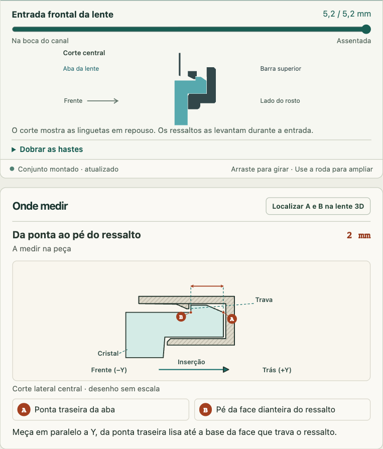

# Haste de reposição para óculos de lente panorâmica

A lente está inteira e a haste quebrou? Este modelo 3MF para impressão 3D permite testar uma haste de reposição com uma lente panorâmica de peça única. A borda superior da lente tem uma aba curva com três ressaltos. Eles entram pela frente da barra e encontram três travas. A armação usa três peças em PETG: uma barra e duas hastes dobráveis, cada uma com o próprio eixo de pontas esféricas.

**[Abrir a demo 3D](https://moraesgil.github.io/haste-oculos-lente-panoramica/)** · **[Baixar o 3MF para Bambu Lab A1 · Bambu Studio 2.9](https://github.com/MoraesGil/haste-oculos-lente-panoramica/releases/download/v0.1.0/haste-oculos-petg.3mf)** · [Baixar o editor HTML para uso offline](https://github.com/MoraesGil/haste-oculos-lente-panoramica/raw/refs/heads/main/index.html)

[](https://moraesgil.github.io/haste-oculos-lente-panoramica/)

## Como reconhecer a lente

Olhe a borda de cima. O ressalto central fica acima do nariz. Há outro de cada lado. Para comparar a sua lente, use o paquímetro entre as pontas para medir a largura e acompanhe a curva para localizar as travas.

| O que comparar | Medida da lente de referência |
| --- | ---: |
| Distância reta entre as pontas da borda superior | 150,5 mm |
| Do centro até cada ressalto lateral, seguindo o arco | 34 mm |
| Espessura da aba lisa / espessura sobre o ressalto | 2,4 / 3,1 mm |
| Quanto a aba entra na barra, da frente para trás | 5,2 mm |

A dobradiça da A1 usa uma esfera de **3,70 mm** em um alojamento nominal de **4,00 mm**. A garganta de **3,54 mm** cria retenção nominal de **0,16 mm no diâmetro**. Na malha, a interferência na passagem caiu de cerca de **0,33 mm para 0,17 mm**. Depois do encaixe, a folga ficou menor para limitar o jogo. O editor permite ajustar as duas medidas separadamente. Use os corpos de prova da mesa 4 para decidir com o seu PETG.

Essas medidas da lente vieram de um exemplar. A demo identifica as medidas estimadas, como a posição da face que prende o ressalto. Compare-as antes de imprimir o conjunto.

## Como usar o editor

1. Abra a demo e mova **Entrada frontal da lente**. O corte central mostra a aba percorrer os 5,2 mm até o batente.
2. Abra **Dobrar as hastes** para ver o fechamento em sequência. Cada haste gira nas duas pontas esféricas integradas.
3. Para adaptar o modelo, selecione uma cota. **Localizar A e B na lente 3D** mostra onde medir quando a cota tem marcação na lente. Digite o valor em milímetros.
4. Use **Salvar HTML** para guardar sua versão editável. Para imprimir uma peça alterada, selecione-a e use **Baixar STL**. O 3MF desta página contém a versão de referência.



## Como imprimir na Bambu Lab A1

1. Baixe o 3MF. No Bambu Studio 2.9, use **Arquivo → Abrir projeto**. Se aparecer uma escolha, abra como **projeto**. Importar apenas a geometria descarta a organização das mesas.
2. Use a lista abaixo para selecionar uma mesa. O projeto usa **Bambu Lab A1**, bico de **0,4 mm** e **PETG**. A configuração usa **Cool Plate SuperTack a 70 °C**. Se a sua A1 usa outra chapa, selecione no fatiador a que está instalada.
3. Comece pela **mesa 4**. Para testar só a dobradiça, deixe imprimíveis apenas os dois corpos curtos. Encaixe a ponta curta de teste no garfo e mova a articulação à mão. As esferas devem entrar com pressão leve, ficar retidas e permitir o giro, sem marcas brancas nem trincas. Use o gabarito maior dessa mesa para verificar a curva da lente e a posição das três travas.
4. Quando os testes servirem, fatie a **mesa 2** para imprimir a barra. Fatie a **mesa 3** para imprimir as duas hastes juntas. Com as três peças em mãos, pressione o eixo de cada haste nos alojamentos da barra e confira o giro.

| Mesa | Conteúdo | Uso |
| --- | --- | --- |
| 1 | Barra com as duas hastes montadas | Prévia do conjunto |
| 2 | Barra central sozinha | Imprimir a peça que recebe a lente |
| 3 | Haste direita e haste esquerda | Imprimir o par na mesma mesa |
| 4 | Gabarito da lente, garfo curto e ponta de haste com esferas | Testar os encaixes antes das peças inteiras |

No teste com o Bambu Studio 2.9.1.70, o projeto reabriu com quatro mesas. O fatiador estimou **11,34 g** para a barra, **9,49 g** para as duas hastes e **9,51 g** para a mesa de testes completa.


**Aba alinhada à boca → avanço frontal → passagem dos três ressaltos → lente assentada.**

Faça a prova de encaixe na bancada. Pare se precisar torcer a lente, se ela só entrar por um lado ou se uma trava ficar fora de posição. A resistência da articulação, a força de retenção e a proteção contra impacto ou laser exigem ensaios físicos. Para exposição a laser, use o conjunto de proteção aprovado pelo fabricante.

## Arquivos

- [Projeto 3MF](modelos/haste-oculos-petg.3mf) para abrir no fatiador.
- [Fonte paramétrica em OpenSCAD](modelos/haste-oculos.scad) para editar as peças.
- [Demo 3D em português](https://moraesgil.github.io/haste-oculos-lente-panoramica/) para conferir medidas e baixar peças individuais.

<details>
<summary>Conferir a integridade do arquivo 3MF</summary>

SHA-256 da versão para download

```text
88afabc2c85c4e4987f0122574ebde6d8133c722430ff18df7983d5e9d04b6b9
```

</details>
