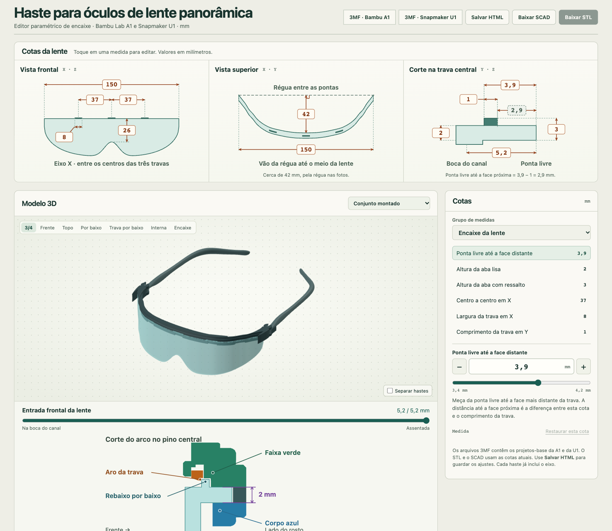
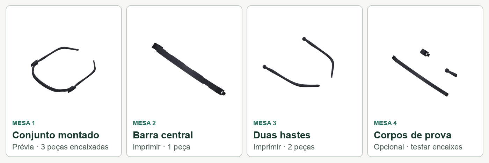
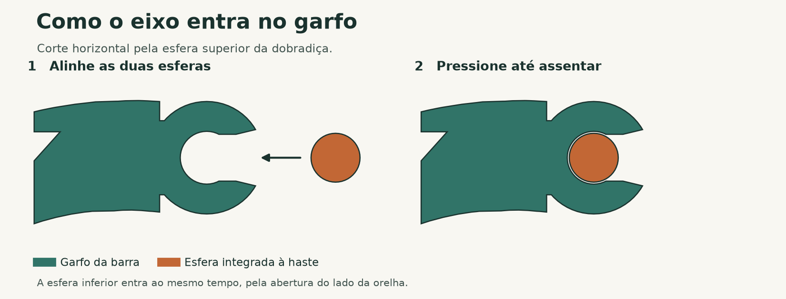

# Haste de reposição para óculos de lente panorâmica

A lente está inteira e a haste quebrou? Este modelo 3MF para impressão 3D permite testar uma haste de reposição com uma lente panorâmica de peça única. A borda superior da lente tem uma aba curva com três ressaltos. Eles entram pela frente da barra e encontram três travas. A armação usa três peças em PETG: uma barra e duas hastes dobráveis, cada uma com o próprio eixo de pontas esféricas.

## Escolha sua impressora

| Impressora | Projeto em PETG | Abra com |
| --- | --- | --- |
| Bambu Lab A1 | [Baixar haste-oculos-petg_A1.3mf](https://github.com/MoraesGil/haste-oculos-lente-panoramica/releases/download/v0.2.0/haste-oculos-petg_A1.3mf) | Bambu Studio 2.9 |
| Snapmaker U1 | [Baixar haste-oculos-petg_U1.3mf](https://github.com/MoraesGil/haste-oculos-lente-panoramica/releases/download/v0.2.0/haste-oculos-petg_U1.3mf) | Snapmaker Orca |

[Baixar o editor HTML para uso offline](https://github.com/MoraesGil/haste-oculos-lente-panoramica/raw/refs/heads/main/index.html)

**Para montar uma armação, imprima a barra da mesa 2 e as duas hastes da mesa 3.** A mesa 1 mostra as três peças montadas. A mesa 4 é opcional e serve para experimentar o encaixe com pouco PETG.

[](https://github.com/MoraesGil/haste-oculos-lente-panoramica/raw/refs/heads/main/index.html)

## Como reconhecer a lente

Olhe a borda de cima. O ressalto central fica acima do nariz. Há outro de cada lado. Para comparar a sua lente, use o paquímetro entre as pontas para medir a largura e acompanhe a curva para localizar as travas.

| O que comparar | Medida da lente de referência |
| --- | ---: |
| Distância reta entre as pontas da borda superior | 150,5 mm |
| Do centro até cada ressalto lateral, seguindo o arco | 34 mm |
| Espessura da aba lisa / espessura sobre o ressalto | 2,4 / 3,1 mm |
| Quanto a aba entra na barra, da frente para trás | 5,2 mm |

A dobradiça usa uma esfera de **3,70 mm** em um alojamento nominal de **4,00 mm**. A garganta de **3,54 mm** cria retenção nominal de **0,16 mm no diâmetro**. Na malha, a interferência na passagem caiu de cerca de **0,33 mm para 0,17 mm**. Depois do encaixe, a folga ficou menor para limitar o jogo. O editor permite ajustar as duas medidas separadamente. Use os corpos de prova da mesa 4 para decidir com o seu PETG.

Essas medidas da lente vieram de um exemplar. A demo identifica as medidas estimadas, como a posição da face que prende o ressalto. Compare-as antes de imprimir o conjunto.

## Como usar o editor

1. Abra a demo e mova **Entrada frontal da lente**. O corte central mostra a aba percorrer os 5,2 mm até o batente.
2. Abra **Dobrar as hastes** para ver o fechamento em sequência. Cada haste gira nas duas pontas esféricas integradas.
3. Para adaptar o modelo, selecione uma cota. **Localizar A e B na lente 3D** mostra onde medir quando a cota tem marcação na lente. Digite o valor em milímetros.
4. Use **Salvar HTML** para guardar sua versão editável. Para imprimir uma peça alterada, selecione-a e use **Baixar STL**. O 3MF desta página contém a versão de referência.


<a id="como-imprimir-na-bambu-lab-a1"></a>

## Como imprimir

1. Escolha o 3MF da sua impressora na tabela acima. Use **Arquivo → Abrir projeto** no fatiador correspondente para carregar as quatro mesas.
2. Confira a impressora, o bico de **0,4 mm** e o material **PETG**. Os arquivos usam a chapa lisa **SuperTack a 70 °C**. Se a chapa instalada for outra, selecione a sua no fatiador.
3. Selecione **Fatiar mesa** para preparar cada mesa que deseja imprimir.

| Mesa | O que aparece no projeto | Quando usar |
| --- | --- | --- |
| **1 · Prévia** | Uma montagem com **três peças**, suspensa 3 mm acima da chapa | Gire o modelo para ver como as hastes entram na barra. Pule esta mesa na impressão. |
| **2 · Barra central** | **Uma peça** com o canal frontal da lente e os dois garfos laterais | Imprima uma vez para montar a armação. |
| **3 · Duas hastes** | **Duas peças** lado a lado, cada uma com o eixo e as duas pontas esféricas integrados | Imprima a mesa uma vez para obter o par. |
| **4 · Testes opcionais** | Um garfo curto, uma ponta curta de haste e um gabarito curvo para a lente | Os dois corpos curtos testam a dobradiça. O gabarito testa a lente. Nenhum deles entra na armação final. |

Para a A1, o Bambu Studio estima **20,24 g de PETG** para a armação completa (10,75 g na mesa 2 e 9,49 g na mesa 3). Os três testes opcionais da mesa 4 somam 9,22 g.



### Como testar e montar a dobradiça

1. Na **mesa 4**, desative o gabarito curvo para imprimir só o **garfo curto** e a **ponta curta da haste**. Use o mesmo PETG e os mesmos ajustes que pretende usar nas peças inteiras.
2. Retire os suportes externos. Segure o garfo perto da abertura. Alinhe as duas esferas da haste com as duas entradas do garfo. Aproxime a haste **do lado da orelha em direção à barra**, como mostra o corte.
3. Pressione as duas esferas juntas. Pare se for preciso forçar ou se o PETG ficar branco ou trincar. Depois de assentar, a haste deve girar à mão e permanecer presa.
4. Aprovado o teste, repita a montagem com a barra da **mesa 2** e cada haste da **mesa 3**. Dobre uma haste por vez.



Nos dois arquivos, a montagem da mesa 1 é um único objeto com três partes. A posição relativa é a mesma das peças impressas depois de encaixadas. As mesas 2, 3 e 4 foram fatiadas no Bambu Studio 2.9.1.70 para a A1 e no Snapmaker Orca para a U1. Os alojamentos, suas entradas e o canal da lente ficaram livres de trajetos de suporte. O teste digital confirmou o assento das quatro esferas e o giro das hastes em sequência. A prova de bancada mede a firmeza com o PETG da sua impressora.

### Como encaixar a lente

**Aba alinhada à boca → avanço frontal → passagem dos três ressaltos → lente assentada.**

Faça a prova de encaixe na bancada. Pare se precisar torcer a lente, se ela só entrar por um lado ou se uma trava ficar fora de posição. A resistência da articulação, a força de retenção e a proteção contra impacto ou laser exigem ensaios físicos. Para exposição a laser, use o conjunto de proteção aprovado pelo fabricante.

## Arquivos

- [Release com os dois projetos 3MF](https://github.com/MoraesGil/haste-oculos-lente-panoramica/releases/tag/v0.2.0) para abrir no fatiador da sua impressora.
- [Fonte paramétrica em OpenSCAD](modelos/haste-oculos.scad) para editar as peças.
- [Editor 3D para uso offline](https://github.com/MoraesGil/haste-oculos-lente-panoramica/raw/refs/heads/main/index.html) para conferir medidas e baixar peças individuais.

<details>
<summary>Conferir os arquivos por SHA-256</summary>

```text
85b8c13aa3fc8f8bd93f9a4a6ad6f3f074bbd163b430092da1aee3110014ea5f  haste-oculos-petg_A1.3mf
2933d905354853ceedc2e8220c561cc03e2ce98a54603371ed97eb75ca882eb0  haste-oculos-petg_U1.3mf
```

</details>
